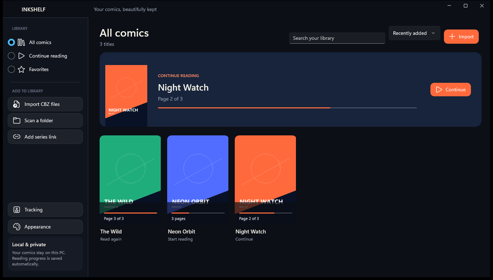
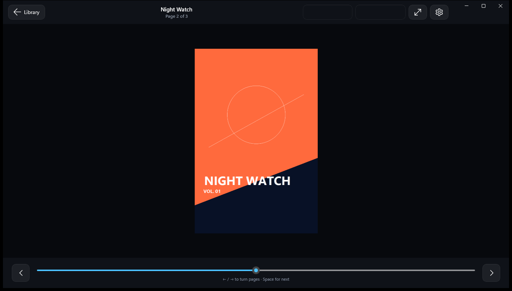

# InkShelf

A local-first CBZ comic and manga reader for Windows, built with **C# / .NET 8 and WinUI 3 (Windows App SDK)**.
It covers the library, reading modes, progress tracking and fully offline Japanese-to-English page translation. Your comics and reading data never leave the PC.



## Features

- **Library**: import one or many `.cbz` files or scan a folder recursively. Cover-first grid with search, sorting, *Continue reading* and favourites.
- **Reader**: single page, two-page spread and vertical scroll. Manga (right-to-left) direction, zoom, page scrubber, full screen and keyboard navigation.
- **Page-turn animations**: None, Fade, Slide, or a 3D page curl.
- **Themes**: System, Light, Dark and a pure-black *Midnight* (OLED) theme, with Coral, Ocean, Emerald and Violet accents. Choices are remembered.
- **Progress** is saved automatically. `ComicInfo.xml` chapter metadata is read when present. Pages sort naturally (`2.jpg` before `10.jpg`). Archive extraction is guarded: pages are written under generated file names, which prevents path-traversal ("zip slip"), and per-page and total size limits stop zip bombs.
- **Offline translation (optional)**: manga-specific OCR plus a local Japanese-to-English model show an English transcript for each page. Results are cached per page and nothing is sent to an online service.
- **Smart Zoom and Guided View**: offline speech-bubble and panel detection gives bubble magnification and panel-by-panel reading, with manga-aware ordering.
- **AniList tracking (optional)**: browser OAuth sign-in, with the token stored in Windows Credential Locker. Includes title matching, chapter and volume mapping, and an offline retry queue.



## Tech stack

| Area | Choice |
|---|---|
| UI | WinUI 3 (Windows App SDK 2.4), XAML, custom page-curl composition animation |
| Language | C# 12 / .NET 8, nullable enabled |
| Storage | JSON library and settings under `%LOCALAPPDATA%\InkShelf`, managed offline copies of imported comics |
| Security | Windows Credential Locker for the OAuth token; zip-slip and zip-bomb safe extraction |
| Offline ML | Python worker process (ONNX Runtime, manga-ocr, Argos Translate / CTranslate2, RapidOCR, OpenCV) driven from C# over stdin/stdout |
| Tracking | Provider-neutral `ITrackerProvider` interface with an AniList implementation |

## Project layout

| Path | Purpose |
|---|---|
| `MainWindow.xaml(.cs)`, `MainWindow.PageCurl.cs` | Shell, library, reader and page-turn animation |
| `Models/` | Comic, translation, speech-bubble and tracking models |
| `Services/LibraryService.cs` | Import, CBZ extraction, covers, progress persistence |
| `Services/OfflineTranslationService.cs`, `BubbleZoomService.cs` | Host the offline OCR/translation and bubble/panel analysis workers |
| `Services/AniListTracker.cs`, `TrackingService.cs` | OAuth sign-in, sync and retry queue |
| `TranslationEngine/` | Python workers and the model provisioning script |
| `TestData/` | Three generated sample comics for trying the app |

## Build and run

**Requirements:** Windows 10 1809 or later (Windows 11 recommended) and the [.NET 8 SDK](https://dotnet.microsoft.com/download/dotnet/8.0). Visual Studio is optional.

```powershell
git clone https://github.com/Prathapdom/InkShelf.git
cd InkShelf

dotnet build InkShelf.csproj -c Debug -p:Platform=x64
.\bin\x64\Debug\net8.0-windows10.0.26100.0\win-x64\InkShelf.exe
```

The build is self-contained, so the Windows App Runtime does not need to be installed.

**Try it with sample comics:** point the app at a throwaway data folder, then use **Import CBZ files** and pick the files in `TestData\Comics`.

```powershell
$env:INKSHELF_DATA_DIR = "$env:TEMP\inkshelf-demo"
.\bin\x64\Debug\net8.0-windows10.0.26100.0\win-x64\InkShelf.exe
```

### Optional: offline translation runtime

The reader works without this. To enable **Translate offline**, add a Python 3.11 runtime at `TranslationRuntime\python.exe` next to `InkShelf.exe`, with the packages listed in [THIRD_PARTY_NOTICES.md](THIRD_PARTY_NOTICES.md) installed. Then download the models once:

```powershell
.\TranslationRuntime\python.exe .\TranslationEngine\provision_models.py .
```

This creates `TranslationModels\` (manga-ocr ONNX weights and the Argos ja→en package). After that, translation runs fully offline. The runtime and models are git-ignored because of their size.

### Optional: AniList tracking

1. Create an API client at <https://anilist.co/settings/developer> with the redirect URL `http://127.0.0.1:43871/callback`.
2. In InkShelf, open **Tracking**, enter the client ID and select **Connect AniList**.
3. Right-click a comic → **Link to AniList…**

## Keyboard

| Key | Action |
|---|---|
| `←` / `→` | Previous / next page (reversed in manga mode) |
| `Space` | Next page, or next panel in Guided View |
| `Esc` | Close Smart Zoom / Guided View, or return to the library |

## Notes

The UI is an original Windows design. No third-party app assets or source code are included.
Licences for the optional offline components are listed in [THIRD_PARTY_NOTICES.md](THIRD_PARTY_NOTICES.md).
